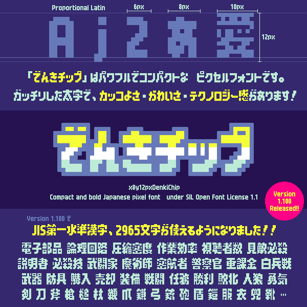

# x8y12pxDenkiChip「でんきチップ」



[](https://github.com/hicchicc/x8y12pxDenkiChip/releases)

## [📦 [Download] x8y12pxDenkiChip.zip](https://github.com/hicchicc/x8y12pxDenkiChip/releases/latest/download/x8y12pxDenkiChip.zip)


## 📝 フォント概要
- 2pxの太線をベースに、コンパクトさと力強さにこだわって制作したピクセルフォントです。
長体の太字がぎっちりと並ぶエネルギー感をお楽しみ下さい。

- 漢字はひらがな・カタカナよりも一回り大きく、テキストの凸凹に楽しさとリズムがあります。

- JIS第1水準漢字と縦書きに対応し、基礎的な日本語テキストに対応できます。

- ピクセル実寸UIにおいて、狭いテキスト領域でも太さのある力強い文字表現が可能です。

## 📐 フォント設計

### 垂直メトリクス設計
- 高さは12pxをほぼ目一杯に使用しており、拡張性は乏しいが運用サイズは最小クラス。
- 文字サイズ`9pt`か`12px`指定で、72dpi環境でドットバイドット表示される想定で設計。

### 水平メトリクス設計
- 数字は`6px`文字送り幅。UI上の桁合わせを想定した等幅設計。
- 欧文はプロポーショナル字幅。一部の組み合わせに疑似的カーニングあり。
- ひらがな・カタカナは`8px`文字送り幅で、テキスト幅を大きく圧縮。
- 漢字は`10px`文字送り幅で、可読性とかな・カナとの対比を生み出しています。

### ビットマップ埋め込み
- TTFファイルは`12px`ビットマップ埋め込みを行っており、対応環境とサイズで表示されます。
- 本リポジトリ内 `fonts/ttf_no-bitmap` 階層の`TTF`ファイルは、ビットマップ埋め込み工程前のファイルです。ビットマップ表示を廃した状態で使用・改変したい場合にご利用ください。ビットマップが埋め込まれたリリース版と同名・同バージョンですので、ファイル容量の差で識別して下さい。


## 📚 実装漢字一覧
### JIS第1水準漢字 2965文字
```
亜唖娃阿哀愛挨姶逢葵茜穐悪握渥旭葦芦鯵梓圧斡扱宛姐虻飴絢綾鮎或粟袷安庵按暗案闇鞍杏以伊位依偉囲夷委威尉惟意慰易椅為畏異移維緯胃萎衣謂違遺医井亥域育郁磯一壱溢逸稲茨芋鰯允印咽員因姻引飲淫胤蔭院陰隠韻吋右宇烏羽迂雨卯鵜窺丑碓臼渦嘘唄欝蔚鰻姥厩浦瓜閏噂云運雲荏餌叡営嬰影映曳栄永泳洩瑛盈穎頴英衛詠鋭液疫益駅悦謁越閲榎厭円園堰奄宴延怨掩援沿演炎焔煙燕猿縁艶苑薗遠鉛鴛塩於汚甥凹央奥往応押旺横欧殴王翁襖鴬鴎黄岡沖荻億屋憶臆桶牡乙俺卸恩温穏音下化仮何伽価佳加可嘉夏嫁家寡科暇果架歌河火珂禍禾稼箇花苛茄荷華菓蝦課嘩貨迦過霞蚊俄峨我牙画臥芽蛾賀雅餓駕介会解回塊壊廻快怪悔恢懐戒拐改魁晦械海灰界皆絵芥蟹開階貝凱劾外咳害崖慨概涯碍蓋街該鎧骸浬馨蛙垣柿蛎鈎劃嚇各廓拡撹格核殻獲確穫覚角赫較郭閣隔革学岳楽額顎掛笠樫橿梶鰍潟割喝恰括活渇滑葛褐轄且鰹叶椛樺鞄株兜竃蒲釜鎌噛鴨栢茅萱粥刈苅瓦乾侃冠寒刊勘勧巻喚堪姦完官寛干幹患感慣憾換敢柑桓棺款歓汗漢澗潅環甘監看竿管簡緩缶翰肝艦莞観諌貫還鑑間閑関陥韓館舘丸含岸巌玩癌眼岩翫贋雁頑顔願企伎危喜器基奇嬉寄岐希幾忌揮机旗既期棋棄機帰毅気汽畿祈季稀紀徽規記貴起軌輝飢騎鬼亀偽儀妓宜戯技擬欺犠疑祇義蟻誼議掬菊鞠吉吃喫桔橘詰砧杵黍却客脚虐逆丘久仇休及吸宮弓急救朽求汲泣灸球究窮笈級糾給旧牛去居巨拒拠挙渠虚許距鋸漁禦魚亨享京供侠僑兇競共凶協匡卿叫喬境峡強彊怯恐恭挟教橋況狂狭矯胸脅興蕎郷鏡響饗驚仰凝尭暁業局曲極玉桐粁僅勤均巾錦斤欣欽琴禁禽筋緊芹菌衿襟謹近金吟銀九倶句区狗玖矩苦躯駆駈駒具愚虞喰空偶寓遇隅串櫛釧屑屈掘窟沓靴轡窪熊隈粂栗繰桑鍬勲君薫訓群軍郡卦袈祁係傾刑兄啓圭珪型契形径恵慶慧憩掲携敬景桂渓畦稽系経継繋罫茎荊蛍計詣警軽頚鶏芸迎鯨劇戟撃激隙桁傑欠決潔穴結血訣月件倹倦健兼券剣喧圏堅嫌建憲懸拳捲検権牽犬献研硯絹県肩見謙賢軒遣鍵険顕験鹸元原厳幻弦減源玄現絃舷言諺限乎個古呼固姑孤己庫弧戸故枯湖狐糊袴股胡菰虎誇跨鈷雇顧鼓五互伍午呉吾娯後御悟梧檎瑚碁語誤護醐乞鯉交佼侯候倖光公功効勾厚口向后喉坑垢好孔孝宏工巧巷幸広庚康弘恒慌抗拘控攻昂晃更杭校梗構江洪浩港溝甲皇硬稿糠紅紘絞綱耕考肯肱腔膏航荒行衡講貢購郊酵鉱砿鋼閤降項香高鴻剛劫号合壕拷濠豪轟麹克刻告国穀酷鵠黒獄漉腰甑忽惚骨狛込此頃今困坤墾婚恨懇昏昆根梱混痕紺艮魂些佐叉唆嵯左差査沙瑳砂詐鎖裟坐座挫債催再最哉塞妻宰彩才採栽歳済災采犀砕砦祭斎細菜裁載際剤在材罪財冴坂阪堺榊肴咲崎埼碕鷺作削咋搾昨朔柵窄策索錯桜鮭笹匙冊刷察拶撮擦札殺薩雑皐鯖捌錆鮫皿晒三傘参山惨撒散桟燦珊産算纂蚕讃賛酸餐斬暫残仕仔伺使刺司史嗣四士始姉姿子屍市師志思指支孜斯施旨枝止死氏獅祉私糸紙紫肢脂至視詞詩試誌諮資賜雌飼歯事似侍児字寺慈持時次滋治爾璽痔磁示而耳自蒔辞汐鹿式識鴫竺軸宍雫七叱執失嫉室悉湿漆疾質実蔀篠偲柴芝屡蕊縞舎写射捨赦斜煮社紗者謝車遮蛇邪借勺尺杓灼爵酌釈錫若寂弱惹主取守手朱殊狩珠種腫趣酒首儒受呪寿授樹綬需囚収周宗就州修愁拾洲秀秋終繍習臭舟蒐衆襲讐蹴輯週酋酬集醜什住充十従戎柔汁渋獣縦重銃叔夙宿淑祝縮粛塾熟出術述俊峻春瞬竣舜駿准循旬楯殉淳準潤盾純巡遵醇順処初所暑曙渚庶緒署書薯藷諸助叙女序徐恕鋤除傷償勝匠升召哨商唱嘗奨妾娼宵将小少尚庄床廠彰承抄招掌捷昇昌昭晶松梢樟樵沼消渉湘焼焦照症省硝礁祥称章笑粧紹肖菖蒋蕉衝裳訟証詔詳象賞醤鉦鍾鐘障鞘上丈丞乗冗剰城場壌嬢常情擾条杖浄状畳穣蒸譲醸錠嘱埴飾拭植殖燭織職色触食蝕辱尻伸信侵唇娠寝審心慎振新晋森榛浸深申疹真神秦紳臣芯薪親診身辛進針震人仁刃塵壬尋甚尽腎訊迅陣靭笥諏須酢図厨逗吹垂帥推水炊睡粋翠衰遂酔錐錘随瑞髄崇嵩数枢趨雛据杉椙菅頗雀裾澄摺寸世瀬畝是凄制勢姓征性成政整星晴棲栖正清牲生盛精聖声製西誠誓請逝醒青静斉税脆隻席惜戚斥昔析石積籍績脊責赤跡蹟碩切拙接摂折設窃節説雪絶舌蝉仙先千占宣専尖川戦扇撰栓栴泉浅洗染潜煎煽旋穿箭線繊羨腺舛船薦詮賎践選遷銭銑閃鮮前善漸然全禅繕膳糎噌塑岨措曾曽楚狙疏疎礎祖租粗素組蘇訴阻遡鼠僧創双叢倉喪壮奏爽宋層匝惣想捜掃挿掻操早曹巣槍槽漕燥争痩相窓糟総綜聡草荘葬蒼藻装走送遭鎗霜騒像増憎臓蔵贈造促側則即息捉束測足速俗属賊族続卒袖其揃存孫尊損村遜他多太汰詑唾堕妥惰打柁舵楕陀駄騨体堆対耐岱帯待怠態戴替泰滞胎腿苔袋貸退逮隊黛鯛代台大第醍題鷹滝瀧卓啄宅托択拓沢濯琢託鐸濁諾茸凧蛸只叩但達辰奪脱巽竪辿棚谷狸鱈樽誰丹単嘆坦担探旦歎淡湛炭短端箪綻耽胆蛋誕鍛団壇弾断暖檀段男談値知地弛恥智池痴稚置致蜘遅馳築畜竹筑蓄逐秩窒茶嫡着中仲宙忠抽昼柱注虫衷註酎鋳駐樗瀦猪苧著貯丁兆凋喋寵帖帳庁弔張彫徴懲挑暢朝潮牒町眺聴脹腸蝶調諜超跳銚長頂鳥勅捗直朕沈珍賃鎮陳津墜椎槌追鎚痛通塚栂掴槻佃漬柘辻蔦綴鍔椿潰坪壷嬬紬爪吊釣鶴亭低停偵剃貞呈堤定帝底庭廷弟悌抵挺提梯汀碇禎程締艇訂諦蹄逓邸鄭釘鼎泥摘擢敵滴的笛適鏑溺哲徹撤轍迭鉄典填天展店添纏甜貼転顛点伝殿澱田電兎吐堵塗妬屠徒斗杜渡登菟賭途都鍍砥砺努度土奴怒倒党冬凍刀唐塔塘套宕島嶋悼投搭東桃梼棟盗淘湯涛灯燈当痘祷等答筒糖統到董蕩藤討謄豆踏逃透鐙陶頭騰闘働動同堂導憧撞洞瞳童胴萄道銅峠鴇匿得徳涜特督禿篤毒独読栃橡凸突椴届鳶苫寅酉瀞噸屯惇敦沌豚遁頓呑曇鈍奈那内乍凪薙謎灘捺鍋楢馴縄畷南楠軟難汝二尼弐迩匂賑肉虹廿日乳入如尿韮任妊忍認濡禰祢寧葱猫熱年念捻撚燃粘乃廼之埜嚢悩濃納能脳膿農覗蚤巴把播覇杷波派琶破婆罵芭馬俳廃拝排敗杯盃牌背肺輩配倍培媒梅楳煤狽買売賠陪這蝿秤矧萩伯剥博拍柏泊白箔粕舶薄迫曝漠爆縛莫駁麦函箱硲箸肇筈櫨幡肌畑畠八鉢溌発醗髪伐罰抜筏閥鳩噺塙蛤隼伴判半反叛帆搬斑板氾汎版犯班畔繁般藩販範釆煩頒飯挽晩番盤磐蕃蛮匪卑否妃庇彼悲扉批披斐比泌疲皮碑秘緋罷肥被誹費避非飛樋簸備尾微枇毘琵眉美鼻柊稗匹疋髭彦膝菱肘弼必畢筆逼桧姫媛紐百謬俵彪標氷漂瓢票表評豹廟描病秒苗錨鋲蒜蛭鰭品彬斌浜瀕貧賓頻敏瓶不付埠夫婦富冨布府怖扶敷斧普浮父符腐膚芙譜負賦赴阜附侮撫武舞葡蕪部封楓風葺蕗伏副復幅服福腹複覆淵弗払沸仏物鮒分吻噴墳憤扮焚奮粉糞紛雰文聞丙併兵塀幣平弊柄並蔽閉陛米頁僻壁癖碧別瞥蔑箆偏変片篇編辺返遍便勉娩弁鞭保舗鋪圃捕歩甫補輔穂募墓慕戊暮母簿菩倣俸包呆報奉宝峰峯崩庖抱捧放方朋法泡烹砲縫胞芳萌蓬蜂褒訪豊邦鋒飽鳳鵬乏亡傍剖坊妨帽忘忙房暴望某棒冒紡肪膨謀貌貿鉾防吠頬北僕卜墨撲朴牧睦穆釦勃没殆堀幌奔本翻凡盆摩磨魔麻埋妹昧枚毎哩槙幕膜枕鮪柾鱒桝亦俣又抹末沫迄侭繭麿万慢満漫蔓味未魅巳箕岬密蜜湊蓑稔脈妙粍民眠務夢無牟矛霧鵡椋婿娘冥名命明盟迷銘鳴姪牝滅免棉綿緬面麺摸模茂妄孟毛猛盲網耗蒙儲木黙目杢勿餅尤戻籾貰問悶紋門匁也冶夜爺耶野弥矢厄役約薬訳躍靖柳薮鑓愉愈油癒諭輸唯佑優勇友宥幽悠憂揖有柚湧涌猶猷由祐裕誘遊邑郵雄融夕予余与誉輿預傭幼妖容庸揚揺擁曜楊様洋溶熔用窯羊耀葉蓉要謡踊遥陽養慾抑欲沃浴翌翼淀羅螺裸来莱頼雷洛絡落酪乱卵嵐欄濫藍蘭覧利吏履李梨理璃痢裏裡里離陸律率立葎掠略劉流溜琉留硫粒隆竜龍侶慮旅虜了亮僚両凌寮料梁涼猟療瞭稜糧良諒遼量陵領力緑倫厘林淋燐琳臨輪隣鱗麟瑠塁涙累類令伶例冷励嶺怜玲礼苓鈴隷零霊麗齢暦歴列劣烈裂廉恋憐漣煉簾練聯蓮連錬呂魯櫓炉賂路露労婁廊弄朗楼榔浪漏牢狼篭老聾蝋郎六麓禄肋録論倭和話歪賄脇惑枠鷲亙亘鰐詫藁蕨椀湾碗腕
```

- 大幅に簡略化された字形も多いため、漢字の正確な画数や読みを必要とするコンテンツへの使用は不向きな面があります。

## 💜 「魔」の略字 ⿸广マ の実装

`U+9B54`「魔」の字形について、略字（⿸广マ）とする予定でしたが、汎用性を鑑みて通常の字形としました。
略字（⿸广マ）については、別途2つの系統で実装しています。

- `U+9B54.ss01`（グラフィック・DTPソフトなどで、スタイリスティックセット１をオンにして利用）
- `U+E100`（コードポイントで私用領域から直接表示。ゲームエンジンなどでの利用を想定）

私用領域`U+E100`は以下からコピーして使用することもできます。お楽しみ下さい。
```

```

## 📅 バージョンアップ履歴
- 2026-11-01 `v1.100` JIS第1水準漢字を追加
- 2026-02-19 `v1.000` 初版リリース

## ⚖️ ライセンス
- `SIL OPEN FONT LICENSE Version 1.1`に準拠して幅広い用途と媒体で自由に利用できます。詳細はライセンス文章や公式サイトをご参照下さい。
- ゲーム開発や翻訳用途などにおける利便性向上のため、予約済みフォント名`RFN`を宣言しません。独自の調整を行っても、元フォント名のまま運用していただけます。（ただし、改変フォント単体で公開する場合、元フォントと誤認するような命名は避ける配慮をお願いします。）

## 🌱 派生フォント


### x10y12pxDenkiChipHangul (전기칩 한글)
https://github.com/quiple/x10y12pxDenkiChipHangul

### 小莉電芯黑 10x12 | Liora Chip 10x12
https://github.com/LioraChen09/LioraChip10x12

派生フォントの制作と発展に、厚く御礼申し上げます。詳細は各リポジトリで確認の上ご活用下さい。